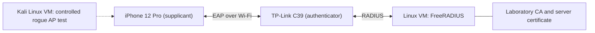
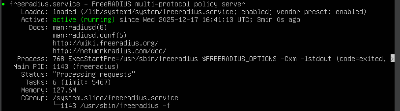
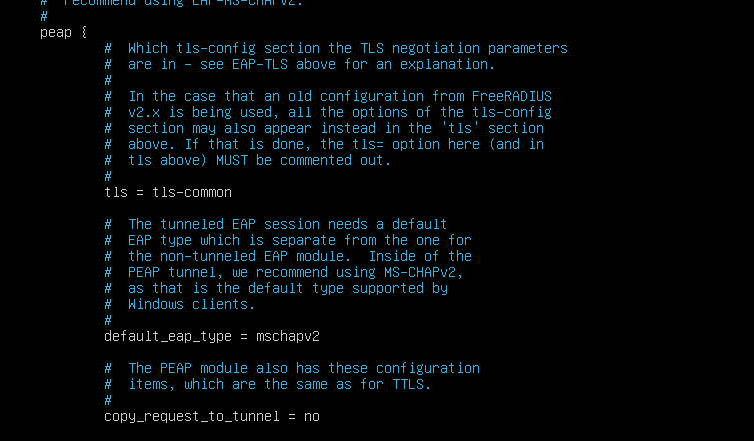

# WPA2-Enterprise Security Research

### 802.1X authentication, certificate trust and Evil Twin resilience

**Görkem Deniz Arslan** · Fontys University of Applied Sciences · Individual cybersecurity research project (2025)

`FreeRADIUS` · `Linux` · `802.1X` · `EAP-PEAP` · `MSCHAPv2` · `TLS/PKI` · `Kali Linux`

## Project overview

I designed, built and tested an enterprise wireless network in an isolated laboratory to investigate whether a rogue access point could compromise user authentication. Unlike a conventional shared-password Wi-Fi network, WPA2-Enterprise authenticates individual users through a central RADIUS server.

The project combined infrastructure deployment, protocol analysis, security testing and troubleshooting. Rather than assuming that an Evil Twin attack would succeed, I first established a working authentication baseline and then compared the legitimate network with controlled adversarial scenarios.

> **Main finding:** the iPhone rejected the unexpected server certificate and no password or inner MSCHAPv2 response was captured. However, temporary wireless disruption and exposure of the outer EAP identity were observed. Certificate trust, identity privacy and network availability are distinct security concerns.

## Lab architecture

| Component | Purpose |
| --- | --- |
| FreeRADIUS on Linux / VirtualBox | Centralized user authentication and authentication logs |
| TP-Link C39 | Wireless authenticator forwarding EAP exchanges to RADIUS |
| iPhone 12 Pro | Client used to validate enterprise access and certificate trust |
| PEAP with inner MSCHAPv2 | Authentication configuration investigated |
| Local certificate authority | Trust relationship for the legitimate authentication server |
| Kali Linux / VMware and Netgear wireless adapters | Controlled wireless security assessment |

## What I implemented personally

1. **Built the network:** deployed the Linux authentication server, configured the wireless access point and connected the client.
2. **Established certificate trust:** configured the laboratory CA and server certificate to support a protected PEAP tunnel.
3. **Validated authentication:** examined RADIUS events, including Access-Request, Access-Challenge and Access-Accept, and confirmed that the client obtained network access.
4. **Evaluated security:** compared normal authentication against controlled deauthentication and rogue-server scenarios, documenting what was and was not observable.
5. **Troubleshot failures:** investigated reachability, RADIUS client settings and certificate configuration; rebuilt parts of the server configuration and restored management connectivity when required.

## Test results

| Test | Actual observation | Security interpretation |
| --- | --- | --- |
| Legitimate enterprise login | Successful PEAP exchange and RADIUS Access-Accept | Authentication baseline verified |
| Controlled deauthentication | Temporary disconnect, followed by reconnection | Availability was affected |
| Rogue authentication server | Client terminated the attempt when presented with an unexpected certificate | Server trust protected the tested configuration |
| Outer EAP identity | Test username observable outside the protected tunnel | Identity privacy was not fully protected |
| Inner credentials | No password or MSCHAPv2 response captured | Credential compromise was not demonstrated |

The negative credential-capture result is an important outcome, not a failed project. It shows how the legitimacy of the authentication server matters even when an attacker can impersonate a wireless network. The result applies to this particular client and configuration; it is not proof that every enterprise Wi-Fi deployment is secure.

## Original laboratory evidence

*FreeRADIUS running and processing requests. Service availability was checked before validating client authentication.*

*Original server configuration excerpt showing the inner authentication method used in the test.*

Further screenshots, the authentication sequence and the detailed observations are available in [Implementation and test evidence](docs/implementation-and-results.md).

## Engineering lessons and defensive recommendations

- Configure clients to validate the expected RADIUS server certificate and identity; do not blindly accept unexpected certificates.
- Treat wireless availability separately from credential confidentiality; review management-frame protection where supported.
- Consider anonymous outer identities where appropriate and certificate-based EAP-TLS for managed enterprise clients.
- Troubleshoot at the correct layer: network reachability, RADIUS service, EAP negotiation, certificate trust and authorization.
- Document negative findings honestly, and repeat tests across different clients and configurations before generalizing.

## Detailed project documentation

| Document | What it covers |
| --- | --- |
| [Research methodology](docs/research-method.md) | Research question, scope, evaluation criteria, threat model and limitations |
| [Implementation and test evidence](docs/implementation-and-results.md) | Lab setup, authentication exchange, original screenshots, troubleshooting and results |
| [Security recommendations](docs/security-recommendations.md) | Defensive controls, interpretation of findings and proposed follow-up validation |

## Skills demonstrated

Network and Linux administration · Centralized authentication · Wireless security · Certificate-based trust · Authentication log analysis · Technical troubleshooting · Security assessment · Evidence-based reporting

## Scope and responsible use

This was an individual academic research project using controlled laboratory equipment, not a production deployment or an attack guide. The conclusions are based on the original report; the public edition excludes credentials, internal IP addresses, identifying screenshots, raw captures and operational attack instructions.

See also my [Cybersecurity Hands-on Labs portfolio](https://github.com/gdarslan/cybersecurity-hands-on-labs) for complementary network defense, monitoring and systems security work.
