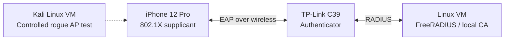

# WPA2-Enterprise Security Research

**Görkem Deniz Arslan | Fontys University of Applied Sciences | Individual applied research, 2025**

An isolated wireless security assessment: building an enterprise Wi-Fi network with centralized 802.1X authentication, validating its operation, and assessing its resistance to rogue access point (Evil Twin) and deauthentication scenarios.

## Research objective

Can an attacker obtain password material from an 802.1X-authenticated network in a controlled laboratory environment? Which authentication controls protect the client, and which risks remain?

## Lab architecture

The Windows host ran the FreeRADIUS VM in VirtualBox and the Kali VM in VMware. The documented test used PEAP with MSCHAPv2, a local CA and a commercial access point. Two Netgear USB wireless adapters supported the controlled wireless assessment.

## Results at a glance

| Scenario | Observed result |
| --- | --- |
| Baseline enterprise authentication | Successful EAP-PEAP exchange and RADIUS Access-Accept; client obtained network access |
| Deauthentication | Temporary loss of connectivity followed by reconnection |
| Rogue authentication server | Client rejected the unexpected server certificate |
| Outer EAP identity | Test username visible outside the protected tunnel |
| Password or MSCHAPv2 response | Not captured in the tested configuration |

**Key finding:** successful authentication and confidentiality are distinct from availability. The client rejected the rogue certificate in this experiment, while the deauthentication scenario interrupted service and the outer identity was observable.

## Research documentation

- [Research scope and methodology](docs/research-method.md)
- [Implementation and test evidence](docs/implementation-and-results.md)
- [Security recommendations and limitations](docs/security-recommendations.md)

## Technical skills demonstrated

FreeRADIUS, Linux administration, 802.1X, EAP, PEAP, TLS and PKI, wireless authentication troubleshooting, Kali Linux, virtualization, threat assessment and technical reporting.

## Scope and responsible use

This is a historical academic research project on owned, controlled lab equipment, not an attack guide. Results apply to the tested client and configuration; they do not establish immunity for every enterprise Wi-Fi deployment. Credentials, raw captures, detailed attack commands and identifying screenshots are excluded from this public portfolio. No production deployment is claimed.
