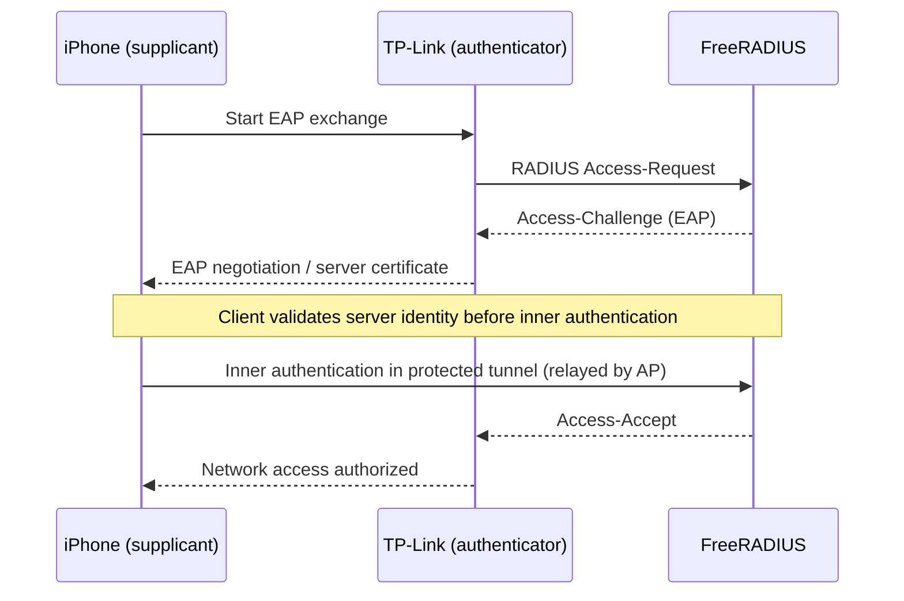

# Implementation and test evidence

## Authentication architecture

| Component | Implemented role |
| --- | --- |
| Windows host | Virtualization workstation |
| Oracle VirtualBox | Linux FreeRADIUS VM |
| TP-Link C39 | WPA2-Enterprise authenticator |
| iPhone 12 Pro | PEAP supplicant |
| VMware Workstation / Kali Linux | Controlled wireless test system |
| Netgear USB Wi-Fi adapters | Wireless test interfaces |

FreeRADIUS was configured with a laboratory CA, server certificate and test identities. The access point forwarded authentication exchanges to the RADIUS server. The client established a TLS tunnel with the legitimate server before completing inner MSCHAPv2 authentication.

## Baseline validation

The report records Access-Request and Access-Challenge messages followed by a successful Access-Accept. The iPhone established the TLS tunnel and obtained an IP address. This established that the legitimate environment worked before adversarial testing.

## Security assessment

| Test | Evidence recorded in the final report | Interpretation |
| --- | --- | --- |
| Legitimate authentication | Successful RADIUS log and client connectivity | Authentication baseline functional |
| Deauthentication | Client disconnected and reconnected after the test stopped | Availability disruption observed; not a confidentiality breach |
| Rogue AP / certificate mismatch | Connection attempt terminated when the unexpected certificate was presented | Server trust checks protected inner authentication in this configuration |
| Outer identity observation | Test username was visible | Identity privacy remains an issue |
| Inner credential observation | No password or MSCHAPv2 response was captured | No demonstrated password compromise |

The report attributes rejection to the client's previously established trust relationship. The experiment did not independently verify every internal iOS trust mechanism, so the observation is reported without asserting universal certificate pinning or platform behavior.

The original project used FreeRADIUS debugging, hostapd-wpe and Aircrack-ng tools; specific attack parameters, credentials and capture files are not published.

## Troubleshooting and professional reflection

- Rebuilt FreeRADIUS after conflicting configuration changes made the environment difficult to maintain.
- Investigated access-point reachability, shared-secret configuration and addressing issues.
- Restored management connectivity after an accidental lockout.
- Used authentication logs to distinguish connectivity, certificate and authentication failures.

The project demonstrated the value of maintaining a reproducible configuration, validating dependencies individually and documenting both positive and negative results.

## Authentication exchange: what I investigated

The most important technical distinction in this project was between the wireless link, the access point's role as authenticator, and the identity decision on the RADIUS server. The access point does not need the user's enterprise password to make its own admission decision; it relays the authentication exchange and applies the server's result.

This is a conceptual message sequence, not a packet-by-packet reconstruction. The original report documented the successful RADIUS debug flow rather than publishing a full packet trace.

### Configuration areas and their significance

| Component | What was configured / checked | Why it mattered |
| --- | --- | --- |
| RADIUS service | Linux VM, service availability and debug output | Verify requests actually reach the authentication server |
| Client definition | Access point registration and matching shared-secret settings | Establish the RADIUS client/server relationship |
| EAP configuration | PEAP and inner MSCHAPv2 authentication | Define the authentication method exercised during testing |
| Certificate configuration | Lab CA and server certificate | Establish server identity and protected tunnel |
| Wireless access point | Enterprise security mode, RADIUS endpoint and matching configuration | Enforce centralized network admission |
| iOS client | Connection profile and trusted legitimate server | Confirm server certificate validation and working login |

The shared secret between the AP and RADIUS server is separate from the test user's password. Actual secrets, key material and internal addresses are excluded.

## Why the negative result matters

The final experiment distinguishes three independent outcomes: whether a device can be disconnected, whether it will start an EAP exchange with an impersonating network, and whether it will continue with inner authentication. A successful disruption or observable outer identity does not establish credential theft.

| Security property | Reported evidence | Assessment |
| --- | --- | --- |
| Availability | Temporary disassociation | Disruption was observed |
| Identity privacy | Outer EAP identity visible | A real username can be exposed by the tested configuration |
| Password confidentiality | No password or MSCHAPv2 response observed | Credential compromise was not demonstrated |
| Server authentication | Unexpected certificate rejected | Trust check was effective in the tested scenario |

MSCHAPv2 challenge-response material should not be described as a plaintext password. The report's research question concerned plaintext credentials, but the outcome also covers the absence of captured inner authentication material.

## Troubleshooting as an engineering task

The report describes difficulties with conflicting EAP and RADIUS client settings, access-point-to-server connectivity, and accidental loss of management access. I had to rebuild the RADIUS configuration when its state became difficult to reason about. Rather than treating successful Wi-Fi association as sufficient, I checked whether the server saw the corresponding request, whether the exchange reached a successful authentication result, and whether the client actually obtained network access.

This gave me practical experience with diagnosing failures at different layers: reachability, service configuration, protocol negotiation, certificate trust and authorization.

## Evidence and traceability

The final PRP report contains screenshots of the RADIUS service, access-point configuration, client connection, authentication debug output, lab topology and controlled tests. This public edition summarizes the observations from those sections without copying raw credential fields, device identifiers, test commands or screenshots that could reveal configuration details. The research plan and presentation were used for context; reported results come from the final report.
